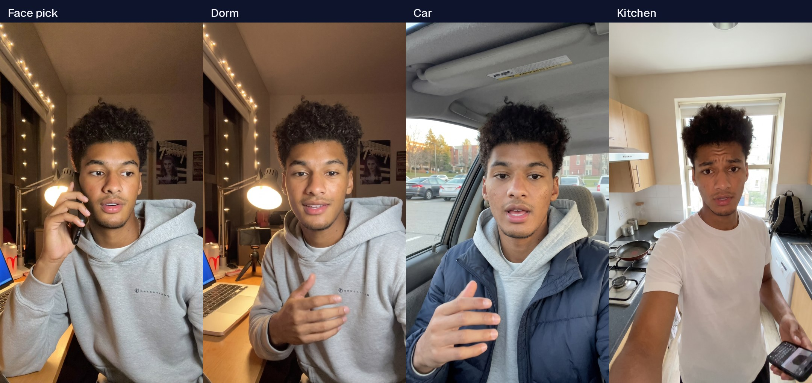

# Jordan: our AI student creator (plan, no video spend yet)

Brief: the COO for the owner, 2026-11-22. One recurring made-up student who makes phone-camera UGC about LifeFlow, very realistic, with LifeFlow's animations moving around him like the campfire and pier videos, and the real app full screen.

## The character

- **Jordan**, 20, sophomore at a community college, works part-time. Made up; not anyone's likeness.
- Look: curly dark hair, light stubble, grey hoodie. Places: dorm at night, his parked car, a shared kitchen, campus.
- Voice: a natural young man's voice, mid-low, relaxed, with real ums, restarts and pauses. Picked by the owner from a short A/B tape before any video.
- Stills used: Soul 2 for the face (4 picks, about 0.5 credits), then Nano Banana Pro for the settings (3, about 6 credits). About 7 credits in all, under the 10 limit. Soul 2 kept putting a phone at his ear and changed his face with the setting; Nano Banana Pro held his face.

## How each video is made

1. **Voice first:** the script read as a voice take (ElevenLabs through Higgsfield text to speech, about 1 credit), ums and pauses written into the text. The owner picks the voice.
2. **Jordan talking:** Higgsfield Intone (a lip-synced talking head from his picture plus the voice, up to 30 s, 1080p, 9:16). Its price is quoted only once a voice file exists, so the first quote comes with the voice tape. Fallback: Seedance 2.5 with his picture, 7 credits a second at 720p (25 s = 175 credits) or about 3 a second at 480p plus our GPU upscale.
3. **Phone-camera realism:** a little handheld shake, light grain and real room tone added in the edit; no beauty filter.
4. **The app, full screen and big:** recorded from production (lifeflowweb.com) on the demo account with made-up data, cut in as full-screen inserts while he keeps talking, never a small phone in a corner. Still to confirm: that production has a demo account we can sign in to.
5. **LifeFlow's animations around him:** the wheel, the skylings and the clouds, the same pieces as the campfire and pier videos, placed behind him (he is cut out of the frame locally) and timed to what he says.
6. **Finish:** launch captions (Fraunces Bold, soft white, gold word), camera always on him while he talks, short intro, calm motion, music under the voice, the end card. Checked against the playbook's minimum bar in 5b before anyone sees it.

## Honesty

- He shows and explains the app. He never claims to be a paying user or quotes results he didn't have (FTC fake-testimonial line). Lines are "look what it does", not "it saved me $500".
- When posted, the TikTok and Instagram AI-generated label is on.
- ADHD angle: speaks to people who find starting hard. Never "do you have ADHD", no medical claims (research: docs/research/2026-11-22-adhd-first.md on claude/adhd-six).

## The reel (owner, 2026-11-22: one real-looking UGC reel, a strong hook, LifeFlow shown clearly)

Jordan has ADHD himself and talks about it the way ADHD creators do, through his own day. He never tells the viewer they have ADHD and never says the app treats or fixes anything; it just makes his days easier. The heart, per the owner: his whole messy week in one glance on the wheel, the skyling planning and organizing it for him, and the timeline that is simple to open. No lists to read: look and know. Left out because they are held: Start it, the class heads-up, Back on track.

**Three hooks for the first 1 to 2 seconds (pick one):**
1. He holds the phone up to the lens, the wheel filling the frame: "This is my entire week. One circle."
2. Straight to camera, deadpan: "I have ADHD. To-do lists don't work on me."
3. A real moment: he stares at a long to-do list on his laptop, closes it: "Yeah, I'm not reading that." Then the wheel.

**The script (dorm at night, about 25 s), after the hook:**
> I have ADHD, so, um... lists don't work on me. I read the first line and I'm gone. So this is my whole week. One wheel. Class, work, the gym, the quiz. It's all just... there. My skyling put it together for me. And if I want the details, I tap the day, and it's one line. What's now, what's next. I look, I know. That's it.

App inserts, full screen from production on the demo account: the wheel (hold 2 s), the skyling and the planned day, the tap that opens the timeline, a slow scroll along it. The wheel and the skylings animate around him while he talks about them.

## Credit quote per video

| Part | Credits |
|---|---|
| Voice take (and A/B tape, once) | about 1 to 2 |
| Jordan talking, Intone 1080p | quoted with the voice tape |
| Or Seedance 2.5, 25 s at 720p | 175 |
| App recording, animations, captions, mix | 0 (done here) |

Nothing is made until the owner sets a budget. Nothing is posted or scheduled by Marketing.

## Voice tape and quote (2026-11-22)

- Tape: `Jordan_voice_tape_A_Dylan_B_Miles.mp3`. A is Dylan reading the whole reel (24.3 s); B is Miles reading the hook and first lines (14.1 s). Both ElevenLabs presets through Higgsfield, about 1.9 credits. A transcribes back word for word (it says "skylin" for "skyling"; the final take will spell it out for the voice). Claude can't hear: the owner picks by ear.
- Talking head, Higgsfield Intone, quoted with voice A over the whole 24 s: 1080p 432 credits, 720p 189, 480p 81. Seedance 2.5 at 480p for 16 s is 48.
- Cheapest good route: Intone at 480p, then our GPU upscale (tested on the drama ad), and only the lines he says on camera go to Intone. The app inserts cover the rest, so about 14 s of him: about 50 credits at 480p, about 110 at 720p (estimates scaled from the quotes above).
- Production demo login: `demo@budgetflow.local` does not sign in on lifeflowweb.com ("That email and password don't match"). The app inserts need a demo account on production.
